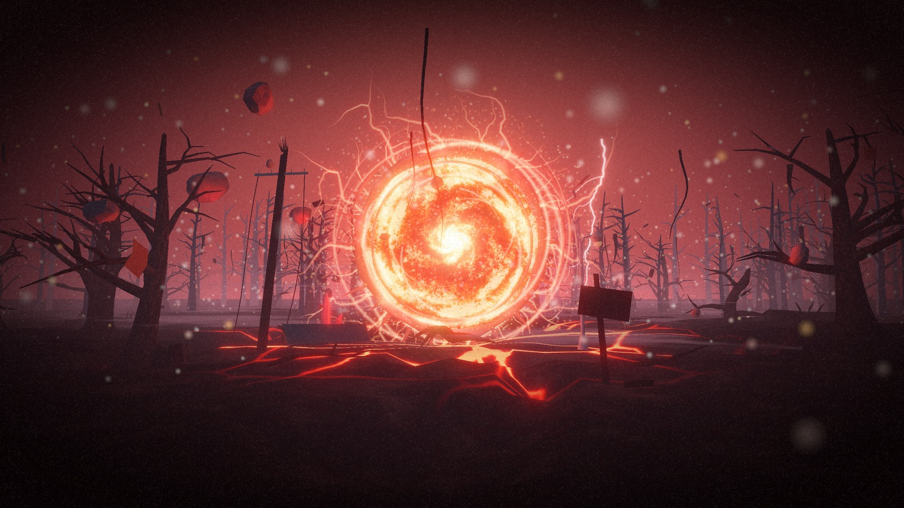

# Code Carnival – 3D asset pack

Procedurally generated, web-ready assets for the opening scene of the AI Student Chapter Code Carnival site: an original dark, red-lit alternate-dimension forest with a central dimensional portal.

## What is inside
- `models/` – 20 GLB files (environment, trees, portal, effects, props). About 145,381 triangles when the whole scene is loaded.
- `textures/` – 12 required texture maps (PBR, portal, fog) + particle sprites and overlays, PNG, with WebP siblings where they are smaller.
- `graphics/` – logo, title, glow, grain, vignette, portal transition, cursor particle.
- `audio/` – 7 original synthesised sounds (WAV + Ogg), all muted until user interaction.
- `animations/` – procedural animation module (Three.js), R3F example, presets, `scene_layout.json` (placement/camera/fog).
- `lighting/` – three lighting presets as JSON.
- `source/` – the Python generators that produced everything, and a Blender script.
- `documentation/` – manifest, model details, material guide, animation guide, licences.

## Quick start (React Three Fiber)
1. Copy this folder into your site's `public/`.
2. `npm i three @react-three/fiber @react-three/drei`
3. Adapt `animations/PortalScene.example.jsx` (placement comes from `animations/scene_layout.json`).

## Honest limitations – read before integrating
1. **No `.blend` files are included.** Blender was not available in the build environment, so the lighting presets are provided as `lighting/*.json` (for Three.js) rather than `lighting_*.blend`. `source/blender/build_blend_files.py` builds `.blend` versions from the GLBs when run in Blender, but it has **not been run or tested**. The files themselves were written with a custom numpy GLB writer, validated by re-parsing (header, accessor bounds, index ranges, normals, texture paths), but **not loaded in Three.js or Blender** here.
2. **The preview is a software render** (custom numpy rasteriser reading the final GLBs): per-vertex lighting, no shadows, no normal maps, simple bloom. Three.js with real PBR, shadows and post-processing will look different (generally richer; fog and glow values will need tuning).
3. Procedural art has limits: the trees are stylised low-poly, the ground has a faint tiling seam, and the audio is synthesised (atmospheric, not studio-grade). Treat this as a strong starting kit, not final AAA art.
4. Textures are 1024 px (the logo and transition are 2048 px). Meshes are not Draco/meshopt compressed.
5. Preview scene triangle count (~127k) suits desktop; see `documentation/MODEL_DETAILS.md` for mobile reductions.
